<!-- Header Section -->

  

  

  
  
  

 

## 👨‍💻 About Me

<table>
<tr>
<td width="55%" valign="top">

Hi, I'm **AL Amin Sarder** 👋, a **CSE Undergraduate @ PUB** and **Mobile App Developer** from **Bogura, Bangladesh** 🇧🇩. I build **innovative Android & cross-platform solutions** along with **scalable full-stack web apps** using the **MERN Stack**.

- 📱 **Android Developer** building modern mobile apps
- 🎓 **CSE Undergraduate @ PUB**
- 🔭 Building with **MongoDB, Express, React, Node.js**
- 🌱 Learning **System Design & Cloud Deployment**
- 🤝 Open to **freelance & open-source collaboration**

</td>
<td width="45%" align="center" valign="middle">

</td>
</tr>
</table>

 

## 💻 Tech Stack

### 🚀 Programming Languages

  
  
  
  
  
  

### 📱 Mobile Development

  
  
  
  
  
  
  

### 🎨 Frontend Development

  
  
  
  
  
  
  
  

### ⚙️ Backend & Build Tools

  
  
  
  
  
  

### 🗄️ Database & Cloud Services

  
  
  
  

### 🧰 Tools & Hosting Platforms

  
  
  
  
  
  
  
  
  
  

 

## 📌 Current Focus

| 🎯 Area | 📝 Details |
|---------|-----------|
| 🏗️ Building | Scalable Full-Stack MERN Applications |
| 📱 Mobile | Android & Cross-Platform App Development |
| 🔌 Backend | RESTful API Design & Security |
| 🎨 Frontend | Modern UI/UX with React & Tailwind CSS |
| 🚀 Goal | Writing Clean, Scalable, Maintainable Code |
| 📖 Learning | System Design & Cloud Deployment |

 

## 🔥 GitHub Streak

  

 

## 📊 GitHub Stats

  

 

## 🌐 Let's Connect

  
  
  
  

  💬 Feel free to reach out for <b>collaborations</b>, <b>freelance projects</b>, or just to <b>say hi</b>! 👋

  

